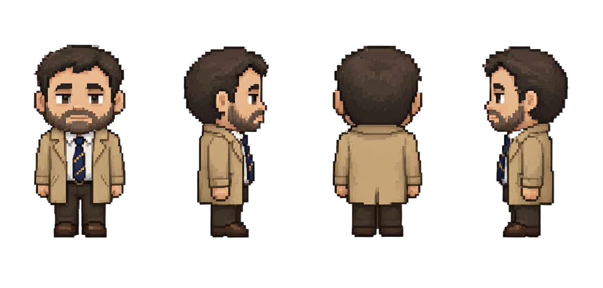
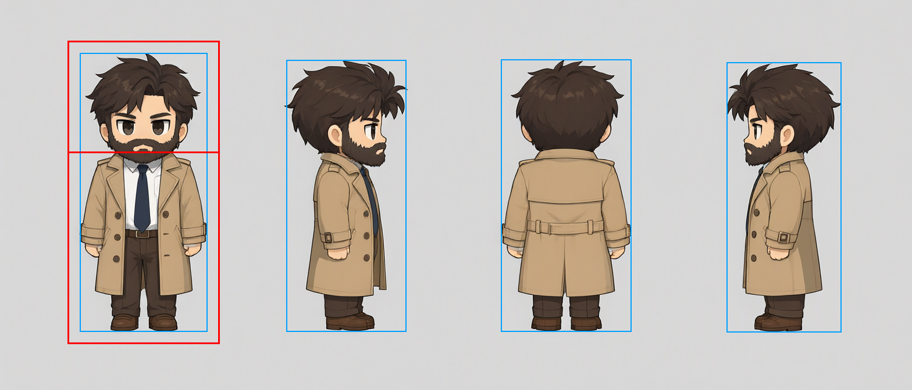

# sprite-forge

Turn a character design into a **48×64, 4-direction RPG walk sheet that is real pixel art**: every pixel on the grid, the same face
and outfit in all 16 frames, and the motion of a proper walk cycle. Built on ComfyUI, with MiniMax H3 doing the character swap and a
few pixel-art tricks doing the rest.

> All example images in this repository are **AI-generated** (MiniMax H3, Qwen-Image 2.1, Stable Diffusion 1.5 with the 8bitdiffuser
> LoRA), then post-processed and hand-fixed. Using the pipeline means using these models under their own licences: see
> [Licences and credits](#licences-and-credits).

| Design sheet | Walk sheet | Walking |
|---|---|---|
|  |  |   |

## The pipeline

**Round one** makes the first sheet from the design. **Round two** reuses its four standing sprites to make any further animation of
the same character with fewer steps.

| # | Step | Script | What it does |
|---|---|---|---|
| 0 | Design sheet | `make_design_sheet.py` (or your own drawing) | The character's look: a full-body front view on a plain light background (side and back views optional). See [The design sheet](#the-design-sheet). |
| 1 | Guide walk | `build_rig_sheet.py` | Your RPG Maker XP style base-body walk (4×4 frames), grown to 48×64 cells. Gives poses and directions. |
| 2 | Character swap | `gen_h3_sheet.py` | MiniMax H3 per direction: the guide row, nearest-upscaled 6× and each pose held 5 frames, is the motion (`<Video 1>`); the design's front view with the head shrunk to 80 % is the character (`<Picture 1>`). Same face and outfit in every frame. |
| 3 | Outline expansion | `gen_px64_pass.py --oe 3` | Each frame resized to 8× (512×640); PixelOE thickens small high-contrast details (tie, outline) so they survive. |
| 4 | Pixel pass | `gen_px64_pass.py --mode sheet` | All 16 frames as one 2048×2560 image, redrawn by SD 1.5 + the 8bitdiffuser 64x LoRA at 0.45. That LoRA draws one flat pixel per 8×8 latent cell, so the next step is lossless. One image for the whole sheet keeps the faces consistent. `--align row` first shifts each row to the grid window that keeps the most outline ink. |
| 5 | Downscale ÷8 | (inside step 4) | k-centroid per 8×8 block with a detail bias (a dark minority of ≥ 40 % wins the block, so eyes and outlines survive; adapted from [sprite-gen](https://github.com/aldegad/sprite-gen)), cropped to 48×64. |
| 6 | Sheet post | `sheet_post.py --stand --colors 32` | Background removed, one 32-colour palette for the sheet, standing frame copied to column 2. |
| 7 | Clean-up rules | `sheet_cleanup.py` | Specks merged, spikes/notches fixed, **head lock** (the standing head copied into the stride frames: identical faces), selective outline; optional design-sheet palette. |
| 8 | Pixel fixes as code | `sheet_to_pxl.py` + [pxl](https://github.com/crsolver/claude-pxl) | The sheet becomes a text file (pixel-exact); fix single pixels in `owens_fixes.px.js` (here: the tie back to navy, symmetric eyes) and export strips, GIFs, Aseprite-style anim JSON and a TexturePacker sheet. |
| R2 | Round two | `gen_h3_sheet.py --k 8 --pad 8 --ref-sheet SHEET` | H3 again, now at 8× with each row's fixed standing sprite (×8) as its reference: H3 copies the pixel blocks, so ÷8 is direct and steps 3–5 drop out. Fixes from step 8 carry into every new frame. Then steps 6–7. |

### Why these steps (what the tests showed)

- **H3** keeps a character consistent across a whole walk and follows the guide pose exactly; Wan 2.2 (first/last frame, Fun Control)
  and MOSS-Image were tried and lost on consistency or followed the guide's body shape instead of the character.
- **The downscale was the real problem.** H3 draws smooth cartoon lines with blocky-looking patches, but no pixel grid at any size
  (step corners cluster on no block size from 2 to 12 px). No window or block size makes a direct downscale lossless.
- **The 8bitdiffuser pass imposes a grid**: SD 1.5's latent is 8×8 pixels, and the LoRA makes each latent cell one flat pixel.
  Redrawing frames one at a time drifts (faces, trouser colours); redrawing the whole sheet as one image does not.
- **PixelOE outline expansion 3** keeps the tie and outline; **head lock** is the biggest clean-up gain.
- **H3 copies a pixel-art reference**, but only at 8×: its video latent works in 32×32-pixel patches, which hold exactly 4×4 sprite
  pixels at 8× and do not tile at 6×.
- **Fix once, inherit everywhere**: pixels fixed in pxl on the standing sprites reappear in every frame H3 generates from them.

The full test write-up (about 15 routes, with GIFs) is not published here, because it shows third-party base-body sprites and
outputs of LoRAs whose licences were not checked; the findings above are its summary.

## Requirements

- An NVIDIA GPU (developed on an RTX 3080 Ti, 12 GB) and **ComfyUI** with the MiniMax H3 nodes (`MiniMaxH3ReferenceToVideo`,
  `MiniMaxH3AddGuide`, `MiniMaxH3SigmaShift`) and the LTX-Video nodes (`LTXVSeparateAVLatent`).
- Models, under the file names the graphs use:

  | Model | File(s) | Licence |
  |---|---|---|
  | MiniMax H3 Ref2VA | `minimax_h3_ref2va_pruned_int8_convrot.safetensors`, `qwen3vl_32b_minimax_h3_nvfp4_awq.safetensors`, `minimax_h3_video_vae_int8_convrot.safetensors`, `minimax_h3_audio_vae_fp32.safetensors` | MiniMax H3 Community License (has regional exclusions; commercial use needs a licence from MiniMax) |
  | H3 LoRAs (in `loras/h3/`) | `minimax_h3_ref2v_turbo_4step_v0.1_comfyui_bf16.safetensors`, `minimax_h3_character_swap_v1.1_ref2va_fro.safetensors` | see their pages |
  | Stable Diffusion 1.5 | `v1-5-pruned.ckpt` | CreativeML Open RAIL-M |
  | 8bitdiffuser 64x v4 | `PX64NOCAP_epoch_10.safetensors` ([Civitai 185743](https://civitai.com/models/185743)) | Civitai: commercial use allowed |

- Python 3.11+ with `pip install -r requirements.txt` (numpy, Pillow, SciPy, PyTorch, [PixelOE](https://github.com/KohakuBlueleaf/PixelOE)).
- For step 8 only: [pxl](https://github.com/crsolver/claude-pxl) (MIT) and Node ≥ 22.18.
- **A base-body walk sheet** in `base_bodies/` (RPG Maker XP layout: 4×4 frames, rows down/left/right/up). Not included: use one you
  are licensed to use.
- **Your character**: a design sheet and `character.py` (see the next section).

Copy `settings.example.json` to `settings.json` and set the ComfyUI input/output folders (and Node/pxl paths for step 8).

## The design sheet

The pipeline only needs one picture of the character: a **full-body front view** on a plain light background. Round one gives H3 that
front view (with its head shrunk to 80 %, `--ref-head 0.8`) and H3 works out the side and back views from it plus the text
description; `sheet_cleanup.py --design` also takes its colours. Round two no longer uses the design at all: its references are round
one's own standing sprites. Side and back views on the same sheet are optional (useful to check the design, and for other tools).

What makes a good front view: the whole body from head to shoes, facing straight at the viewer, arms down and a little away from the
body, chibi proportions close to the target sprite (big head, short body), clean outlines and flat colours, nothing behind the figure.

**Make one** with `make_design_sheet.py`: it puts the base body's four standing frames side by side (front, right, back, left) as a
mannequin, and Qwen-Image 2.1 (edit, Turbo 8-step LoRA) dresses it as `character.DESCRIPTION` in one call, so the same person comes out
from four sides at the base body's size. Seeds differ a lot: make a few and pick one.

```bash
python make_design_sheet.py Men01 --seeds 1,2,3       # -> work/design_Men01_s<seed>.png, each measured
python make_design_sheet.py --measure my_drawing.png  # measure a design sheet you made yourself
```

Needs `qwen_image_2.1_int8_convrot.safetensors`, `qwen3vl_8b_int8_convrot.safetensors`, `qwen_image_2.1_vae_bf16.safetensors` and
`Qwen-Image-2.1-Turbo8-8step-lora.safetensors` in ComfyUI.

**Then fill in `character.py`**: `DESCRIPTION` (one line, used in every prompt), `DESIGN_SHEET` (the image), and the two numbers the
script prints for it: `FRONT_CROP`, the front view's box (left, top, right, bottom) with a small margin, and `NECK`, the row inside that
box where the head ends (the narrowest row between head and shoulders; `--ref-head` shrinks everything above it). The script writes
`<name>_measure.png` with the boxes (blue: the figures, red: the front crop and the neck line) so you can check them.



*Owens made by `make_design_sheet.py Men01 --seeds 1`, with the measurement drawn on. (The example sheets below were made from an
earlier Owens design, `examples/owens/owens_4view.png`, drawn the same way on a Blender mannequin.)*

## Commands

```bash
# design (once per character): make or draw one, then put DESCRIPTION, DESIGN_SHEET, FRONT_CROP and NECK into character.py
python make_design_sheet.py Men01 --seeds 1,2,3

# round one
python build_rig_sheet.py Men01 --grow 1.5                                    # -> work/rig_Men01_body_big_1x.png
python gen_h3_sheet.py owens --calm --big --rig rig_Men01_body_big --k 6 --pad 8 --ref-head 0.8
python gen_px64_pass.py owens_px --src owens --denoise 0.45 --mode sheet --oe 3 --align row
python sheet_post.py owens_px --stand --colors 32 --out owens_px_rpg
python sheet_cleanup.py owens_px_rpg owens_final --orphans --silhouette --headlock --selout   # --design 24: design-sheet palette

# pixel fixes (optional): convert, edit work/pxl/owens_fixes.px.js, build
python sheet_to_pxl.py owens_final
node22 <pxl>/bin/pxl.js ascii work/pxl/owens_walk.px.js owens_down_0       # the frame as palette keys with rulers
node22 <pxl>/bin/pxl.js build work/pxl/owens_walk.px.js                    # -> work/pxl/out/

# round two: the same character, reference sprites from round one
python gen_h3_sheet.py owens_r2 --calm --big --rig rig_Men01_body_big --k 8 --pad 8 --ref-sheet work/pxl/out/owens_walk_sheet.png
python sheet_post.py owens_r2 --stand --colors 32 --out owens_r2_rpg
python sheet_cleanup.py owens_r2_rpg owens_r2_final --orphans --silhouette --headlock --selout
```

**Check the back row.** H3 sometimes turns the back view to face the camera in the later frames of the video (seen in round two
with several references and both prompt templates). Re-roll just that row into the same sheet with another seed, then redo the
later steps: `python gen_h3_sheet.py owens_r2 ... --rows 3 --seed 2`.

Results land in `work/` (`<tag>_sheet.png` is the finished RGBA sheet, plus one GIF per direction). Each step takes a few minutes on
a 12 GB card: H3 about 1.5 min per direction, the pixel pass about 4 min.

Other tools: `gen_pixeloe.py` (PixelOE as the downscaler itself; not better than k-centroid) and `ink_align.py` (direct ÷6 at the
window with the most outline ink).

## Status

The whole pipeline (round one, pxl, round two) was run end to end from this repository on 2026-11-01. The H3 prompt template in
`prompts/h3_swap.txt` is written for this repo in the structured section format H3 prompts use; the example images below were made
with an earlier template that is not included. `--prompt FILE` takes any other template (`[add description here]` is replaced by the
character description).

## Example: Owens

`examples/owens/` holds the design sheet, the sheets from each stage (`sheets/`), walk GIFs, before/after comparisons, the pxl
source with its fixes and exports (`pxl/`).

| Pass + rules | Round two | Fixes carried into round two |
|---|---|---|
|  |  |  |

## Licences and credits

- **Code:** MIT (`LICENSE`), except the detail-bias function in `pixelops.py`, adapted from
  [sprite-gen](https://github.com/aldegad/sprite-gen) (Copyright 2026 Alex Kim, Apache-2.0, `LICENSES/Apache-2.0.txt`). See `NOTICE`.
- **Credits:** k-centroid downscaling after Astropulse (Retro Diffusion); outline expansion by
  [PixelOE](https://github.com/KohakuBlueleaf/PixelOE) (KohakuBlueleaf); pixel fixes and exports with
  [pxl](https://github.com/crsolver/claude-pxl) (crsolver); everything runs in [ComfyUI](https://github.com/comfyanonymous/ComfyUI).
  Full list with licences: [THIRD_PARTY_NOTICES.md](THIRD_PARTY_NOTICES.md).
- **Models:** none are included; each has its own licence. In particular **MiniMax H3** (Community License Agreement): use and
  distribution only outside the EU, UK, South Korea and USA (outputs included); outputs may not be used to train other AI models;
  a commercial product or service using it must show "MiniMax H3" prominently in its UI; AI-generated content shared publicly must
  be disclosed as such. MiniMax H3 is licensed under the MiniMax H3 Community License Agreement. Copyright © 2026 MiniMax. All Rights
  Reserved.
- **Examples:** the Owens character and all images in `examples/owens/` are © themessie, all rights reserved, and AI-generated.
- **Base bodies** are not included; use sprites you have the rights to.

This is a summary, not legal advice; the licence texts linked in THIRD_PARTY_NOTICES.md are what count.
