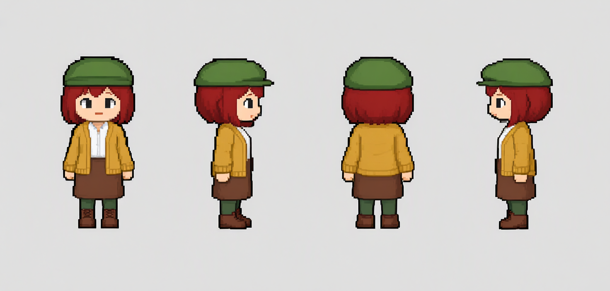
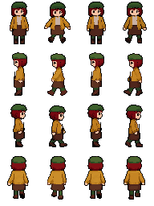
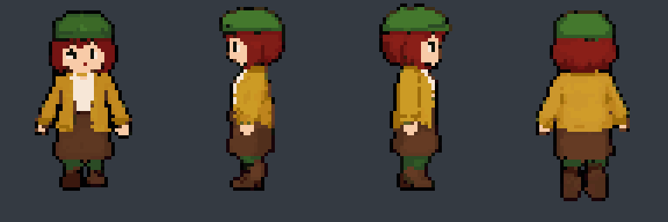
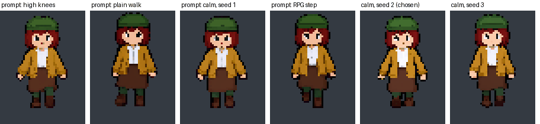
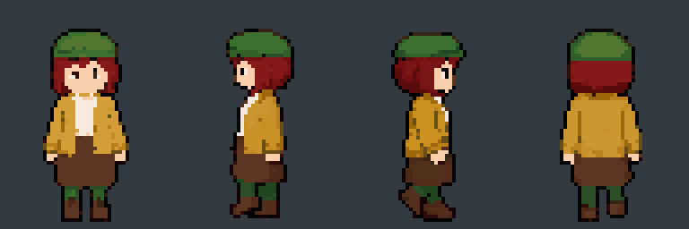
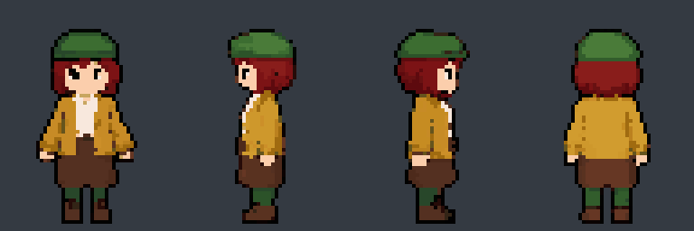
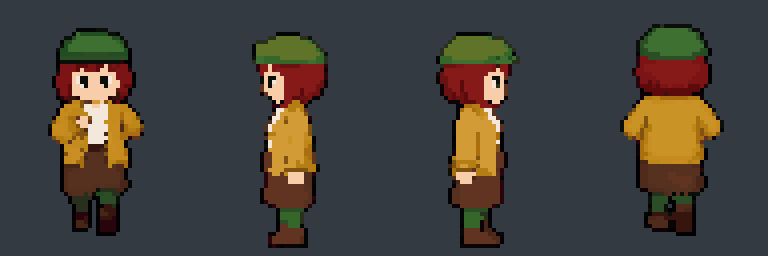
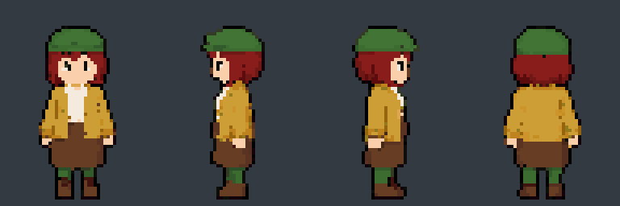
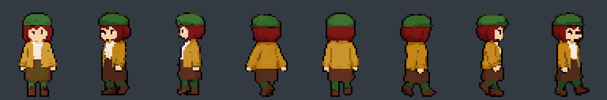
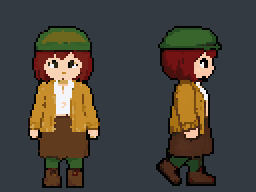

# sprite-forge

Turn a character design into a **48×64, 4-direction RPG walk sheet that is real pixel art**: every pixel on the grid, the same face
and outfit in every frame, and the motion of a proper walk cycle. Built on ComfyUI, with two routes:

| Route | Models | Results |
|---|---|---|
| **Wan route** (shown here) | Qwen-Image 2.1 + Wan 2.2 (Apache-2.0) | Good, and shareable anywhere |
| **H3 route** | MiniMax H3 + SD 1.5 + 8bitdiffuser | Better: crisper, exact poses. But its licence bars showing H3 outputs in the EU, UK, South Korea and USA, so **no H3 results are published here** |

> All example images in this repository are **AI-generated** (Qwen-Image 2.1, Wan 2.2), then post-processed by this pipeline.
> Using the pipeline means using these models under their own licences: see [Licences and credits](#licences-and-credits).

| Design (simple style) | Walk sheet | Walking |
|---|---|---|
|  |  |  |

*Mara, a newspaper seller, made entirely with the Wan route (front, left, right, back; 48×64 cells).*

## The Wan route

| # | Step | Script | What it does |
|---|---|---|---|
| 0 | Design sheet | `make_design_sheet.py --style simple` | Qwen-Image 2.1 dresses the base body's four standing views as your character: the same person from front, right, back and left. **Simple style**: thick dark outlines, flat colours, no small details, so it survives the shrink to 48×64. See [The design sheet](#the-design-sheet). |
| 1 | Walk loops | `gen_wan_walk.py` | Per direction, Wan 2.2 image-to-video walks in place from that view and back to it (a loop), on a magenta canvas that is keyed out by hue. The 4 frames are picked from the gait: the most closed pose and the two strides (by leg spread for the sides, by foot lift for front and back). Front and back walks get a calm, small-steps prompt (see [Parameters](#parameters-gen_wan_walkpy) and the [sensitivity analysis](#sensitivity-analysis-the-front-walk)). |
| 2 | Downscale ÷8 | (inside step 1) | Frames are made at exactly 8× the sprite (512×640 for 48×64 + 8 px margin); k-centroid per 8×8 block with true colours. |
| 3 | Sheet post | `sheet_post.py --stand --colors 32` | Background removed, one 32-colour palette for the sheet, standing frame copied to column 2. |
| 4 | Clean-up rules | `sheet_cleanup.py --thin ...` | Doubled outlines thinned to 1 px, specks merged, spikes/notches fixed, **head lock** (the standing head copied into the stride frames), selective outline. |
| 5 | Pixel fixes (optional) | `sheet_to_pxl.py` + [pxl](https://github.com/crsolver/claude-pxl) | The sheet becomes a text file (pixel-exact); fix single pixels as code and export strips, GIFs, Aseprite-style anim JSON and a TexturePacker sheet. |
| R2 | Round two (optional) | `gen_wan_walk.py --start-sheet SHEET` | Wan starts from the finished standing sprites (×8) instead of the design, for further takes of the same character. |

```bash
export SPRITE_FORGE_CHARACTER=mara                            # characters/mara.json
python make_design_sheet.py Women01 --style simple --seeds 1,2,3,4   # pick one, set design_sheet in characters/mara.json
python build_rig_sheet.py Men01 --grow 1.5                    # guide geometry (figure size, foot line) for step 1
python gen_wan_walk.py mara_walk --seed 2                     # 4 directions, about 3 min each on a 12 GB card
python sheet_post.py mara_walk --stand --colors 32 --out mara_walk_rpg
python sheet_cleanup.py mara_walk_rpg mara_final --thin --orphans --silhouette --headlock --selout
```

### What the tests showed (Wan route)

- **The design decides most of it.** The same pipeline on a detailed design (freckles, knit texture, buttons) gives muddy faces at
  48×64; a design drawn for a tiny sprite (thick outlines, flat colours, big shapes) gives clean, readable frames.
  ([comparison](examples/mara/cmp_detailed_vs_simple.png); the detailed attempt is from the first round¹)
- **Direct ÷8 beats every pixel-pass variant** on Wan frames of a simple design: the SD 1.5 + 8bitdiffuser pass that the H3 route
  needs only adds noise here (at 0.35 and more so at 0.45), and starting Wan from a pixelated image or adding the Wan 2.1 Pixel
  Toolkit LoRA does not help either. ([12 variants](examples/mara/cmp_route_variants.png), first round¹)
- **k-centroid darkens**: a block half outline, half fill goes wholly to the winner, so outlines and dark areas grow; the colour
  rounding (`//8`) adds a little. True colours plus outline thinning undo most of it.
  ([comparison](examples/mara/cmp_downscale_darkening.png))
- Wan keeps the facing direction in all four views (H3 sometimes turns the back view around), and its side strides are lively. Its
  front and back walks need the right prompt and picker (below).

### Parameters (`gen_wan_walk.py`)

| Option | Default | What it does, and what the tests showed |
|---|---|---|
| `--seed` | 1 | Matters for front and back walks: try 2–3 seeds and keep the best (Mara: seed 2). |
| `--walk0` / `--walk3` | calm walk | The front / back walk phrase: a calm pace, small natural steps, arms close to the body, no jumping. |
| `--high-steps` | none | Rows that get an extra "high knee lifts" sentence. No gain once the start image is right. |
| `--pick` | auto | Frame picking: `lift` (one foot raised, little splay) for front/back, `spread` (widest step) for the sides. |
| `--bg` | magenta | Canvas background, keyed out afterwards by hue (red and blue well above green), because Wan lets it drift from pink to purple. Grey looked like white clothing and was keyed away with it; use `grey` or `green` for pink or magenta characters. |
| `--frames` | 33 | Clip length. 49 gave a slower, steadier walk (less colour drift) but no better poses.¹ |
| `--steps`, `--shift` | 4, 5 | Sampler steps (the lightx2v LoRAs are 4-step) and shift. 8 steps or shift 8 gave less foot lift.¹ |
| `--ref-head` | 0.8 | Shrinks the design's head in the start image. 1.0 gave a narrower stance but a bigger head.¹ |
| `--rows` | 0,1,2,3 | Redo some rows; they merge into the existing sheet. |
| `--repick` | off | Pick frames again from this tag's existing clips, without running Wan. |
| `--start-sheet` | – | Round two: start from finished standing sprites (×8). |
| `--pixel-start`, `--pixel-lora` | off | Pixelate the start image / add the Wan 2.1 Pixel Toolkit LoRA. No gain in our tests. |

¹ Measured in the first round, whose start images had the bug described below; the relative effects are likely to hold.

Downstream defaults: k-centroid ÷8 with true colours; `sheet_post.py --colors 32`; `sheet_cleanup.py --thin
--orphans --silhouette --headlock --selout`. The SD 1.5 pixel pass (`gen_px64_pass.py`) is optional on this route and only added noise
on simple designs (denoise 0.35 / 0.45, with or without PixelOE).

### Sensitivity analysis: the front walk

Front walks were the weak spot, so we varied one thing at a time on Mara's front row and measured each clip with `sensitivity.py`:
**lift** = how far one foot rises above the other, **splay** = sideways leg spread, **arms** = arm span, **bob** = change in figure
height, all as a share of the figure height; **drift** = how much the figure's colours change against the first frame (Lab distance).
A good front walk has high lift and low splay, arms, bob and drift.

| Run (correct start images, magenta background) | Lift ↑ | Splay ↓ | Arms ↓ | Bob ↓ | Drift ↓ |
|---|---|---|---|---|---|
| prompt: high knees | 0.059 | 0.33 | 0.59 | 0.033 | 10.8 |
| prompt: plain walk | 0.087 | 0.44 | 0.59 | 0.045 | 11.4 |
| prompt: calm, seed 1 | 0.059 | 0.33 | 0.58 | 0.040 | 10.3 |
| prompt: RPG step | 0.059 | 0.34 | 0.56 | 0.061 | 9.8 |
| calm, seed 2 (chosen) | 0.061 | 0.34 | 0.53 | 0.045 | 5.2 |
| calm, seed 3 | 0.041 | 0.33 | 0.53 | 0.035 | 6.7 |

- **The start image mattered most.** The first round of runs looked like hopping or shuffling because the start image was wrong: the
  design's white blouse had been cut out together with the sheet's light-grey background, so Wan started from (and drew) a grey
  blouse, which then got keyed away. With that fixed (only background connected to the border is removed) and a magenta canvas,
  every prompt gives a reasonable walk.
- **Prompt:** a modest effect once the input is right. "Plain walk" lifts the feet most but also splays the legs most; the calm prompt
  keeps the stance narrow.
- **Seed:** seeds 2 and 3 drift about half as much as seed 1; calm + seed 2 has the least drift and the narrowest arms, and looked
  best by eye. That is Mara's sheet.
- **Picking matters as much as generating:** the widest-leg frames of a front walk are splayed poses; picking by foot lift finds real
  steps (the picture below shows both).



*The corrected front-walk runs, frames picked by foot lift. Stills with both pickers: [front_sensitivity.png](examples/mara/front_sensitivity.png).*

## Any animation: `forge.py`

The same Wan route, generalised: **any animation, 1 to 8 directions, any frame count, any sprite size**, one command.

| Walk (8 frames) | Idle (6) | Run (8) | Wave (one-shot, 8) |
|---|---|---|---|
|  |  |  |  |

| 8 directions | 64×96 |
|---|---|
|  |  |

```bash
export SPRITE_FORGE_CHARACTER=mara
python forge.py walk                                             # 8 frames, down/left/right/up, 48x64
python forge.py idle --frames 6
python forge.py wave --dirs down
python forge.py walk --cell 64x96 --dirs down,right
python forge.py walk --dirs down,down_left,left,up_left,up,up_right,right,down_right   # needs design_diagonals
python forge.py walk --frames 12                                 # re-cut from the cached clips: no GPU time
```

1. **Start image per direction:** the view from the design sheet (down, right, up, left) or from the character's three-quarter sheet
   (`make_design_sheet.py --diagonals` makes one: front-left, front-right, back-left, back-right), head shrunk (`--ref-head`), placed
   on a magenta canvas at 8× the cell (+ margin).
2. **One Wan 2.2 clip per direction:** the animation's motion text (per direction if given), the facing, and "a seamless loop" or
   "starts and ends in the same pose"; start image = end image.
3. **Frame selection:** loops find the period at which the figure repeats best (background blanked: Wan's magenta drifts) and take N
   frames evenly over one cycle; if nothing repeats clearly, N frames over the whole clip (it loops by construction). One-shots take N
   frames evenly over the clip.
4. **Pixelation:** k-centroid ÷8 with true colours (`--pixel direct`), or a smooth downscale (`--pixel none`).
5. **Finish:** magenta key, one palette (`--colors`), outline thinning, specks, spikes, head lock (if the animation sets it), selective
   outline.
6. **Export** to `work/forge/<tag>/`: `<tag>_sheet.png` (rows = directions, columns = frames), `<tag>.json` (Aseprite-style frames
   with durations from the fps, one frame tag per direction), a GIF per direction and one with all directions.

Every clip is cached (`clips.json`, keyed by direction, seed, size and the exact prompt), so changing the frame count or pixel mode
later costs no GPU time, while editing an animation's wording renders only the directions it changes (`--regen` renders everything
again). `--mirror-left` builds left-facing rows by mirroring the right-facing ones (half the Wan time; wrong for
asymmetric outfits).

**Animations** are small JSON files in `animations/`:

```json
{ "name": "walk", "loop": true, "frames": 8, "fps": 10, "clip_frames": 33,
  "motion": "walking in place at a calm pace with small natural steps, ...",
  "motion_by_dir": { "left": "walking in place with clear, alternating steps, ...", "right": "..." },
  "headlock": true }
```

`loop`: a looping animation (walk, run, idle) or a one-shot that returns to the start pose (wave, attack). `motion_by_dir` overrides
the motion for some directions (front and back walks need calmer wording than side walks). `headlock` copies the first frame's head
into the others; leave it off for animations that move the head.

**What the test matrix showed (Mara):** walk, idle, run and wave all work in four directions; the 8-direction walk works from Qwen's
three-quarter views; 64×96 gives clearly more detail; 32×48 is fine; **32×32 is too small for this chibi** (about 27 px tall, thin and
noisy): better for rounder, simpler characters. The front run first came out with the hands crossing the chest, which turns
into noise at 48×64; `motion_by_dir` for front and back ("arms bent at the sides, the hands never cross in front of the chest") and a
seed check fixed it, as with the walk. About 3 minutes per direction on a 12 GB card (2.3 at 32×32, 3.6 at 64×96).

## The H3 route

Higher quality where you may use it: MiniMax H3 swaps your character onto an RPG Maker base-body walk, so poses follow the guide
exactly; an 8bitdiffuser pixel pass puts the frames on a true pixel grid.

| # | Step | Script | What it does |
|---|---|---|---|
| 1 | Guide walk | `build_rig_sheet.py` | Your RPG Maker XP style base-body walk (4×4 frames), grown to 48×64 cells. |
| 2 | Character swap | `gen_h3_sheet.py` | MiniMax H3 per direction: the guide row, nearest-upscaled 6× and each pose held 5 frames, is the motion (`<Video 1>`); the design's front view with the head shrunk to 80 % is the character (`<Picture 1>`). |
| 3 | Outline expansion | `gen_px64_pass.py --oe 3` | Each frame at 8× (512×640); PixelOE thickens small high-contrast details so they survive. |
| 4 | Pixel pass | `gen_px64_pass.py --mode sheet` | All 16 frames as one 2048×2560 image, redrawn by SD 1.5 + the 8bitdiffuser 64x LoRA at 0.45 (one flat pixel per 8×8 latent cell), then ÷8. `--align row` shifts each row to the grid window that keeps the most outline ink. |
| 5–7 | Post, clean-up, pixel fixes | as in the Wan route | |
| R2 | Round two | `gen_h3_sheet.py --k 8 --pad 8 --ref-sheet SHEET` | H3 at 8× with each row's standing sprite as its reference copies the pixel blocks, so ÷8 is direct and steps 3–4 drop out. Fixes made in pxl carry into every new frame. |

```bash
python build_rig_sheet.py Men01 --grow 1.5
python gen_h3_sheet.py owens --calm --big --rig rig_Men01_body_big --k 6 --pad 8 --ref-head 0.8
python gen_px64_pass.py owens_px --src owens --denoise 0.45 --mode sheet --oe 3 --align row
python sheet_post.py owens_px --stand --colors 32 --out owens_px_rpg
python sheet_cleanup.py owens_px_rpg owens_final --orphans --silhouette --headlock --selout
python gen_h3_sheet.py owens_r2 --calm --big --rig rig_Men01_body_big --k 8 --pad 8 --ref-sheet owens_final_sheet.png   # round two
```

What the tests showed: H3 keeps a character consistent and follows the guide pose exactly. It draws smooth lines with no pixel grid
of its own (step corners cluster on no block size from 2 to 12 px), so no downscale window makes it lossless; the 8bitdiffuser pass
imposes the grid, best when the whole sheet is redrawn as one image. At 8× with a pixel-art reference per direction, H3 copies the
pixel blocks (its 32×32-pixel latent patches hold exactly 4×4 sprite pixels at 8×). **Check the back row:** H3 sometimes turns the
back view to face the camera in later frames; re-roll that row with `--rows 3 --seed 2`. The prompt template is
`prompts/h3_swap.txt` (`--prompt FILE` for another).

## The design sheet

The front view is what matters most (it is the H3 reference, and both routes take its colours); the side and back views are the Wan
route's start images. A good design for a 48×64 sprite: the whole body from head to shoes, chibi proportions, **thick dark
outlines, flat colours, big simple shapes, no small details**.

```bash
python make_design_sheet.py Women01 --style simple --seeds 1,2,3,4   # -> work/design_Women01_simple_s<seed>.png, each measured
python make_design_sheet.py --measure my_drawing.png                 # measure a design sheet you drew yourself
python make_design_sheet.py --diagonals --seeds 1,2,3                # three-quarter views for 8 directions (set design_diagonals)
```

It puts the base body's four standing frames side by side as a mannequin, and Qwen-Image 2.1 (edit, Turbo 8-step LoRA) dresses it as
the character's description in one call. Seeds differ a lot: make a few and pick one
([detailed](examples/mara/cmp_detailed_designs.png) vs [simple](examples/mara/cmp_simple_designs.png) style).

**Characters** live in `characters/<name>.json`: `description` (one line, used in every prompt), `design_sheet`, and optionally
`design_diagonals` (three-quarter views for 8 directions), `front_crop` and `neck` (measured from the sheet when left out). Pick one with `"character"` in `settings.json` or
`SPRITE_FORGE_CHARACTER`.

## Requirements

- An NVIDIA GPU (developed on an RTX 3080 Ti, 12 GB) and **ComfyUI** with
  [Kijai's WanVideoWrapper](https://github.com/kijai/ComfyUI-WanVideoWrapper) (Wan route) and/or the MiniMax H3 and LTX-Video nodes
  (H3 route).
- Models, under the file names the graphs use:

  | Model | File(s) | Route | Licence |
  |---|---|---|---|
  | Qwen-Image 2.1 + Turbo 8-step LoRA | `qwen_image_2.1_int8_convrot`, `qwen3vl_8b_int8_convrot`, `qwen_image_2.1_vae_bf16`, `Qwen-Image-2.1-Turbo8-8step-lora` | both (design) | Apache-2.0 |
  | Wan 2.2 I2V A14B (GGUF) | `Wan2.2-I2V-A14B-High/LowNoise-Q5_K_S.gguf`, `wan_2.1_vae`, `umt5-xxl-enc-fp8_e4m3fn` | Wan | Apache-2.0 |
  | lightx2v 4-step LoRAs | `wan2.2_i2v_A14b_high/low_noise_lora_rank64_lightx2v_4step_1022` | Wan | see the model page |
  | MiniMax H3 Ref2VA + LoRAs | `minimax_h3_ref2va_pruned_int8_convrot`, `qwen3vl_32b_minimax_h3_nvfp4_awq`, H3 VAEs, `h3/minimax_h3_ref2v_turbo_4step_v0.1`, `h3/minimax_h3_character_swap_v1.1` | H3 | MiniMax H3 Community License |
  | Stable Diffusion 1.5 + 8bitdiffuser 64x v4 | `v1-5-pruned.ckpt`, `PX64NOCAP_epoch_10` ([Civitai 185743](https://civitai.com/models/185743)) | H3 (pixel pass) | CreativeML Open RAIL-M |

- Python 3.11+ with `pip install -r requirements.txt`.
- For pixel fixes: [pxl](https://github.com/crsolver/claude-pxl) (MIT) and Node ≥ 22.18.
- **A base-body walk sheet** in `base_bodies/` (RPG Maker XP layout: 4×4 frames, rows down/left/right/up), used as the design
  mannequin and the H3 guide. Not included: use one you are licensed to use.

Copy `settings.example.json` to `settings.json` and set the ComfyUI input/output folders (and Node/pxl paths for pixel fixes).

## Status

Both routes were run end to end from this repository (H3 on 2026-11-01, Wan on 2026-11-03). Other tools: `gen_pixeloe.py` (PixelOE
as the downscaler) and `ink_align.py` (direct ÷6 at the window with the most outline ink).

## Licences and credits

- **Code:** MIT (`LICENSE`). See `NOTICE`.
- **Credits:** k-centroid downscaling after Astropulse (Retro Diffusion); outline expansion by
  [PixelOE](https://github.com/KohakuBlueleaf/PixelOE) (KohakuBlueleaf); pixel fixes and exports with
  [pxl](https://github.com/crsolver/claude-pxl) (crsolver); Wan runs through Kijai's WanVideoWrapper; everything runs in
  [ComfyUI](https://github.com/comfyanonymous/ComfyUI). Full list with licences: [THIRD_PARTY_NOTICES.md](THIRD_PARTY_NOTICES.md).
- **Models:** none are included; each has its own licence. **MiniMax H3** (Community License Agreement, H3 route only): use and
  distribution only outside the EU, UK, South Korea and USA (outputs included); outputs may not be used to train other AI models; a
  commercial product or service using it must show "MiniMax H3" prominently in its UI; AI-generated content shared publicly must be
  disclosed as such. MiniMax H3 is licensed under the MiniMax H3 Community License Agreement. Copyright © 2026 MiniMax. All Rights
  Reserved.
- **Examples:** the Owens and Mara characters and all images in `examples/` are © themessie, all rights reserved, and AI-generated.
- **Base bodies** are not included; use sprites you have the rights to.

This is a summary, not legal advice; the licence texts linked in THIRD_PARTY_NOTICES.md are what count.
